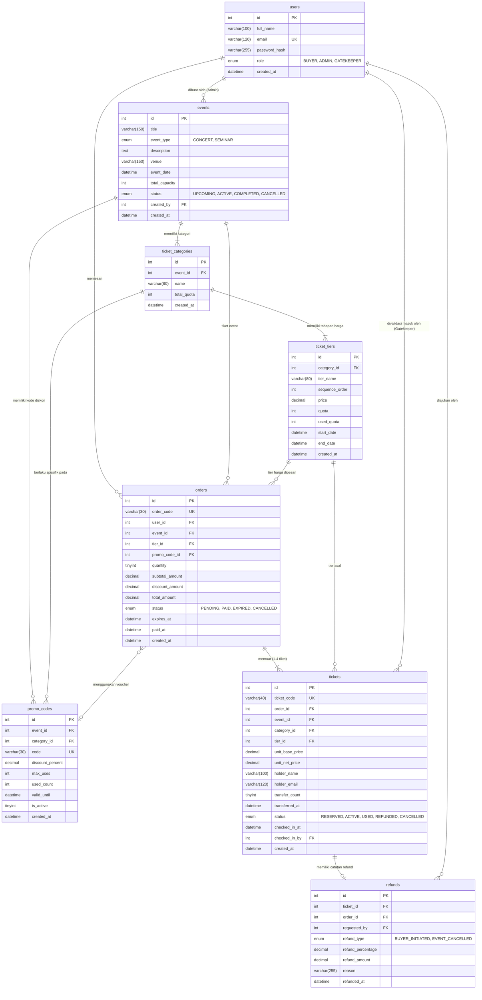

# Spesifikasi Skema Database, Relasi & Skrip DDL (MySQL 8 InnoDB)
## Sistem Penjualan Tiket Event Musik Kampus (KampusTix)

---

## 1. Diagram Relasi Entitas (Mermaid ERD)



---

## 2. Skrip DDL Resmi (MySQL 8 InnoDB - UTF8MB4)

Skrip ini telah disinkronkan dan menyempurnakan celah inkonsistensi antara `PRD 1.pdf` dan `ERD.pdf`.

```sql
-- Nonaktifkan pengecekan foreign key sementara untuk inisialisasi bersih
SET FOREIGN_KEY_CHECKS = 0;

DROP TABLE IF EXISTS refunds;
DROP TABLE IF EXISTS tickets;
DROP TABLE IF EXISTS orders;
DROP TABLE IF EXISTS promo_codes;
DROP TABLE IF EXISTS ticket_tiers;
DROP TABLE IF EXISTS ticket_categories;
DROP TABLE IF EXISTS events;
DROP TABLE IF EXISTS users;

SET FOREIGN_KEY_CHECKS = 1;

-- 1. TABEL PENGGUNA (Auth & RBAC) - Modul Anggota 1
CREATE TABLE users (
    id INT AUTO_INCREMENT PRIMARY KEY,
    full_name VARCHAR(100) NOT NULL,
    email VARCHAR(120) NOT NULL UNIQUE,
    password_hash VARCHAR(255) NOT NULL,
    role ENUM('BUYER', 'ADMIN', 'GATEKEEPER') NOT NULL DEFAULT 'BUYER',
    created_at DATETIME NOT NULL DEFAULT CURRENT_TIMESTAMP
) ENGINE=InnoDB DEFAULT CHARSET=utf8mb4 COLLATE=utf8mb4_unicode_ci;

-- 2. TABEL EVENT MASTER - Modul Anggota 2
CREATE TABLE events (
    id INT AUTO_INCREMENT PRIMARY KEY,
    title VARCHAR(150) NOT NULL,
    event_type ENUM('CONCERT', 'SEMINAR') NOT NULL DEFAULT 'CONCERT',
    description TEXT NULL,
    venue VARCHAR(150) NOT NULL,
    event_date DATETIME NOT NULL,
    total_capacity INT NOT NULL,
    status ENUM('UPCOMING', 'ACTIVE', 'COMPLETED', 'CANCELLED') NOT NULL DEFAULT 'UPCOMING',
    created_by INT NOT NULL,
    created_at DATETIME NOT NULL DEFAULT CURRENT_TIMESTAMP,
    FOREIGN KEY (created_by) REFERENCES users(id) ON DELETE RESTRICT
) ENGINE=InnoDB DEFAULT CHARSET=utf8mb4 COLLATE=utf8mb4_unicode_ci;

-- 3. TABEL KATEGORI TIKET - Modul Anggota 2
CREATE TABLE ticket_categories (
    id INT AUTO_INCREMENT PRIMARY KEY,
    event_id INT NOT NULL,
    name VARCHAR(80) NOT NULL,
    total_quota INT NOT NULL,
    created_at DATETIME NOT NULL DEFAULT CURRENT_TIMESTAMP,
    FOREIGN KEY (event_id) REFERENCES events(id) ON DELETE CASCADE
) ENGINE=InnoDB DEFAULT CHARSET=utf8mb4 COLLATE=utf8mb4_unicode_ci;

-- 4. TABEL TAHAPAN HARGA (TIER ROLLOVER) - Modul Anggota 2
CREATE TABLE ticket_tiers (
    id INT AUTO_INCREMENT PRIMARY KEY,
    category_id INT NOT NULL,
    tier_name VARCHAR(80) NOT NULL,
    sequence_order INT NOT NULL,
    price DECIMAL(12, 2) NOT NULL,
    quota INT NOT NULL,
    used_quota INT NOT NULL DEFAULT 0,
    start_date DATETIME NOT NULL,
    end_date DATETIME NOT NULL,
    created_at DATETIME NOT NULL DEFAULT CURRENT_TIMESTAMP,
    FOREIGN KEY (category_id) REFERENCES ticket_categories(id) ON DELETE CASCADE,
    CONSTRAINT chk_tier_quota CHECK (used_quota <= quota)
) ENGINE=InnoDB DEFAULT CHARSET=utf8mb4 COLLATE=utf8mb4_unicode_ci;

-- 5. TABEL KODE PROMO - Modul Anggota 4
CREATE TABLE promo_codes (
    id INT AUTO_INCREMENT PRIMARY KEY,
    event_id INT NOT NULL,
    category_id INT NULL,
    code VARCHAR(30) NOT NULL UNIQUE,
    discount_percent DECIMAL(5, 2) NOT NULL,
    max_uses INT NOT NULL,
    used_count INT NOT NULL DEFAULT 0,
    valid_until DATETIME NOT NULL,
    is_active TINYINT(1) NOT NULL DEFAULT 1,
    created_at DATETIME NOT NULL DEFAULT CURRENT_TIMESTAMP,
    FOREIGN KEY (event_id) REFERENCES events(id) ON DELETE CASCADE,
    FOREIGN KEY (category_id) REFERENCES ticket_categories(id) ON DELETE SET NULL,
    CONSTRAINT chk_promo_uses CHECK (used_count <= max_uses)
) ENGINE=InnoDB DEFAULT CHARSET=utf8mb4 COLLATE=utf8mb4_unicode_ci;

-- 6. TABEL PESANAN (15-MINUTE HOLD) - Modul Anggota 3
CREATE TABLE orders (
    id INT AUTO_INCREMENT PRIMARY KEY,
    order_code VARCHAR(30) NOT NULL UNIQUE,
    user_id INT NOT NULL,
    event_id INT NOT NULL,
    tier_id INT NOT NULL,
    promo_code_id INT NULL,
    quantity TINYINT NOT NULL,
    subtotal_amount DECIMAL(12, 2) NOT NULL,
    discount_amount DECIMAL(12, 2) NOT NULL DEFAULT 0.00,
    total_amount DECIMAL(12, 2) NOT NULL,
    status ENUM('PENDING', 'PAID', 'EXPIRED', 'CANCELLED') NOT NULL DEFAULT 'PENDING',
    expires_at DATETIME NOT NULL,
    paid_at DATETIME NULL,
    created_at DATETIME NOT NULL DEFAULT CURRENT_TIMESTAMP,
    FOREIGN KEY (user_id) REFERENCES users(id) ON DELETE RESTRICT,
    FOREIGN KEY (event_id) REFERENCES events(id) ON DELETE RESTRICT,
    FOREIGN KEY (tier_id) REFERENCES ticket_tiers(id) ON DELETE RESTRICT,
    FOREIGN KEY (promo_code_id) REFERENCES promo_codes(id) ON DELETE SET NULL
) ENGINE=InnoDB DEFAULT CHARSET=utf8mb4 COLLATE=utf8mb4_unicode_ci;

-- 7. TABEL TIKET INDIVIDUAL (BOARDING PASS) - Modul Anggota 3, 5, 6
CREATE TABLE tickets (
    id INT AUTO_INCREMENT PRIMARY KEY,
    ticket_code VARCHAR(40) NOT NULL UNIQUE,
    order_id INT NOT NULL,
    event_id INT NOT NULL,
    category_id INT NOT NULL,
    tier_id INT NOT NULL,
    unit_base_price DECIMAL(12, 2) NOT NULL,
    unit_net_price DECIMAL(12, 2) NOT NULL,
    holder_name VARCHAR(100) NOT NULL,
    holder_email VARCHAR(120) NOT NULL,
    transfer_count TINYINT NOT NULL DEFAULT 0,
    transferred_at DATETIME NULL,
    status ENUM('RESERVED', 'ACTIVE', 'USED', 'REFUNDED', 'CANCELLED') NOT NULL DEFAULT 'RESERVED',
    checked_in_at DATETIME NULL,
    checked_in_by INT NULL,
    created_at DATETIME NOT NULL DEFAULT CURRENT_TIMESTAMP,
    FOREIGN KEY (order_id) REFERENCES orders(id) ON DELETE CASCADE,
    FOREIGN KEY (event_id) REFERENCES events(id) ON DELETE RESTRICT,
    FOREIGN KEY (category_id) REFERENCES ticket_categories(id) ON DELETE RESTRICT,
    FOREIGN KEY (tier_id) REFERENCES ticket_tiers(id) ON DELETE RESTRICT,
    FOREIGN KEY (checked_in_by) REFERENCES users(id) ON DELETE SET NULL,
    CONSTRAINT chk_ticket_transfer CHECK (transfer_count <= 1)
) ENGINE=InnoDB DEFAULT CHARSET=utf8mb4 COLLATE=utf8mb4_unicode_ci;

-- 8. TABEL PENGEMBALIAN DANA (REFUNDS) - Modul Anggota 5
CREATE TABLE refunds (
    id INT AUTO_INCREMENT PRIMARY KEY,
    ticket_id INT NOT NULL UNIQUE,
    order_id INT NOT NULL,
    requested_by INT NOT NULL,
    refund_type ENUM('BUYER_INITIATED', 'EVENT_CANCELLED') NOT NULL,
    refund_percentage DECIMAL(5, 2) NOT NULL,
    refund_amount DECIMAL(12, 2) NOT NULL,
    reason VARCHAR(255) NULL,
    refunded_at DATETIME NOT NULL DEFAULT CURRENT_TIMESTAMP,
    FOREIGN KEY (ticket_id) REFERENCES tickets(id) ON DELETE RESTRICT,
    FOREIGN KEY (order_id) REFERENCES orders(id) ON DELETE RESTRICT,
    FOREIGN KEY (requested_by) REFERENCES users(id) ON DELETE RESTRICT
) ENGINE=InnoDB DEFAULT CHARSET=utf8mb4 COLLATE=utf8mb4_unicode_ci;
```

---

## 3. Matriks Sifat Transaksi & Penguncian Database (ACID Protection)

| Kasus Bisnis | Teknik SQL Wajib | Tujuan Proteksi |
|---|---|---|
| **Checkout & Hold Kuota** | `SELECT quota, used_quota FROM ticket_tiers WHERE id = ? FOR UPDATE;` | Mencegah race condition ketika 2 pembeli checkout tiket terakhir secara serentak. |
| **Simulasi Bayar** | `SELECT status, expires_at FROM orders WHERE id = ? FOR UPDATE;` | Memastikan pembeli tidak bisa membayar pesanan yang sudah melewati batas 15 menit. |
| **Check-in Pintu Masuk** | `UPDATE tickets SET status = 'USED', checked_in_at = NOW(), checked_in_by = ? WHERE ticket_code = ? AND status = 'ACTIVE';` | Jika `RowsAffected == 0`, tolak seketika (mencegah double scan kode tiket yang sama). |
