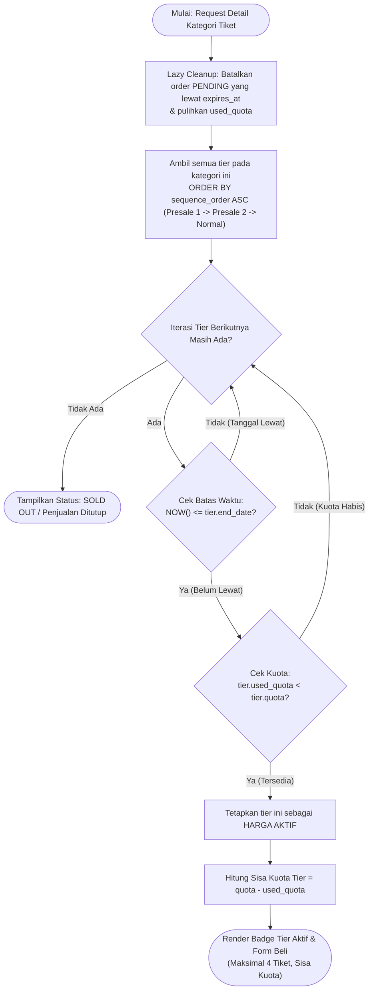
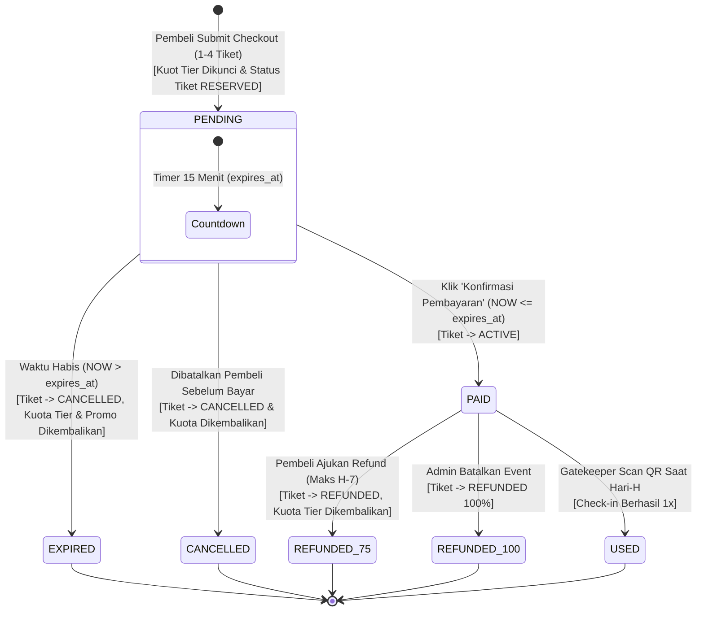
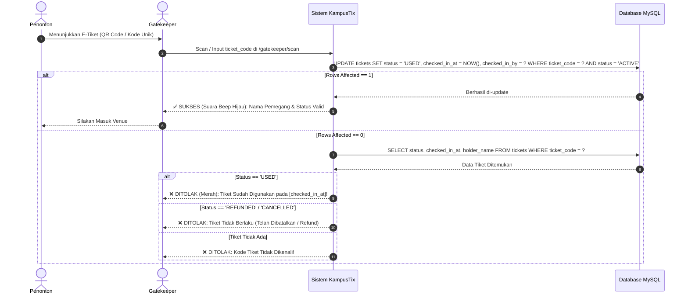

# Dokumentasi Alur Logika Sistem (System Flow & State Machine)
## Sistem Penjualan Tiket Event Musik Kampus (KampusTix)

Dokumen ini melengkapi dan merinci 2 diagram alur yang ada pada folder `Flow/`:
1. `pemweb-Flowchart Penentu Harga Aktif (Tier Rollover).png`
2. `pemweb-State Machine Pesanan & Tiket (15-Minute Hold).drawio.png`

---

## 1. Alur Penentu Harga Aktif Otomatis (*Tier Rollover*)

Berdasarkan flowchart di `pemweb-Flowchart Penentu Harga Aktif (Tier Rollover).png`:



### Implementasi Query Go (Repository):
```sql
SELECT id, category_id, tier_name, price, quota, used_quota, sequence_order, end_date
FROM ticket_tiers
WHERE category_id = ?
  AND end_date >= NOW()
  AND used_quota < quota
ORDER BY sequence_order ASC
LIMIT 1;
```
*Jika query mengembalikan `sql.ErrNoRows`, maka kategori tiket dinyatakan **SOLD OUT**.*

---

## 2. Diagram State Machine Pesanan (`orders`) & Tiket (`tickets`)

Berdasarkan `pemweb-State Machine Pesanan & Tiket (15-Minute Hold).drawio.png`:



### Matriks Transisi Status Tiket:

| Status Asal | Event / Aksi | Status Tujuan | Efek Samping (Side Effect) |
|---|---|---|---|
| *(None)* | Pembeli Checkout | `RESERVED` | `used_quota` tier bertambah sejumlah kuantiti. |
| `RESERVED` | Bayar Terkonfirmasi | `ACTIVE` | Tiket siap dicetak / QR Code aktif. |
| `RESERVED` | Expired / Dibatalkan | `CANCELLED` | `used_quota` tier dikurangi kembali; kuota promo dipulihkan. |
| `ACTIVE` | Pemindahan Tiket | `ACTIVE` | `holder_name` & `holder_email` berubah; `transfer_count` = 1 (fitur terkunci). |
| `ACTIVE` | Refund Mandiri (H-7) | `REFUNDED` | `used_quota` tier dikurangi 1 (bisa dibeli orang lain); dana kembali 75%. |
| `ACTIVE` | Event Dibatalkan | `REFUNDED` | Tiket mati; dana kembali 100%. Kuota tidak dilepas. |
| `ACTIVE` | Check-in Gatekeeper | `USED` | `checked_in_at = NOW()`; scan kedua ditolak. |

---

## 3. Alur Detail Validasi Gatekeeper (Pintu Masuk)


